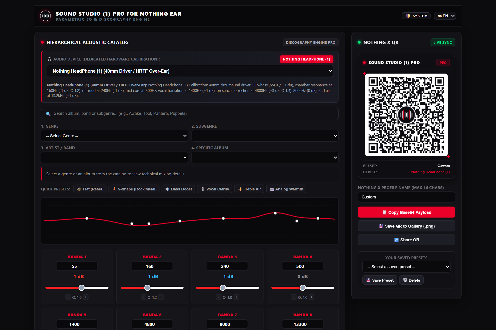
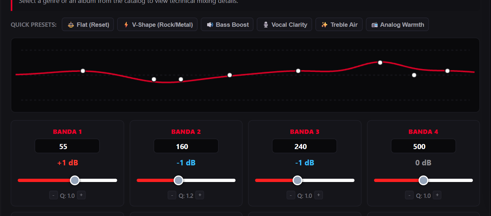
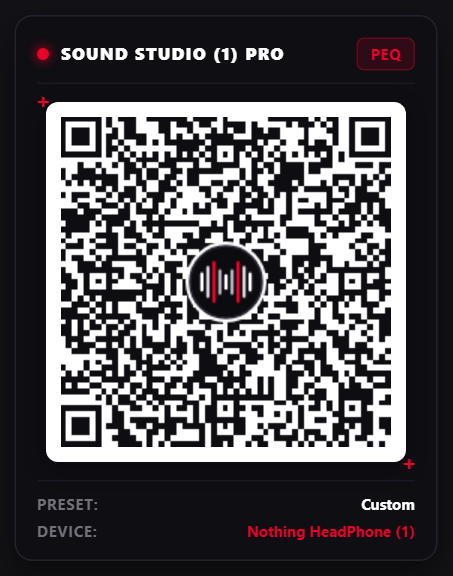
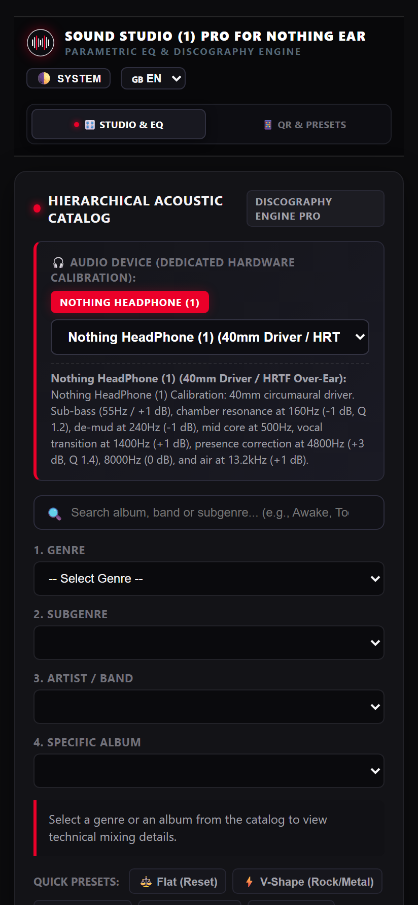
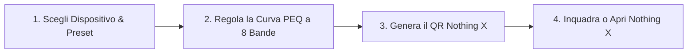

# Sound Studio (1) Pro per Nothing Ear

<div align="center">

```
   _____                      _    _____ _             _ _         __ __   _____           
  / ____|                    | |  / ____| |           | (_)       /_ /_ | |  __ \          
 | (___   ___  _   _ _ __   __| | | (___ | |_ _   _  __| |_  ___   | || | | |__) | __ ___  
  \___ \ / _ \| | | | '_ \ / _` |  \___ \| __| | | |/ _` | |/ _ \  | || | |  ___/ '__/ _ \ 
  ____) | (_) | |_| | | | | (_| |  ____) | |_| |_| | (_| | | (_) | | || | | |   | | | (_) |
 |_____/ \___/ \__,_|_| |_|\__,_| |_____/ \__|\__,_|\__,_|_|\___/  |_||_| |_|   |_|  \___/ 
```

**La Suite Definitiva di Mastering Acustico & Motore PEQ Parametrico per Auricolari e Cuffie Nothing**

[](https://sound-studio-1-pro.pages.dev/)
[](LICENSE.md)
[](#-catalogo-discografico-curato-1231-profili)
[](#-100-offline--standalone-pwa-zero-cdn-esterne)
[](#-protocollo-qr-code-nothing-x-nativo)
[](https://revolut.me/sokkapkd)
[](#-autore--copyright)

<br>

🌐 **Web App Online:** [**sound-studio-1-pro.pages.dev**](https://sound-studio-1-pro.pages.dev/)  
🌐 **Leggi in altre lingue:** [🇬🇧 **English**](README.md)

<br>

[](https://sound-studio-1-pro.pages.dev/)

</div>

---

## 📑 Indice dei Contenuti

- [🎧 Panoramica](#-panoramica)
- [✨ Funzionalità Principali](#-funzionalità-principali)
  - [🎛️ Motore PEQ a 8 Bande & Curva Parametrica su Canvas](#️-motore-peq-a-8-bande--curva-parametrica-su-canvas)
  - [📚 Catalogo Discografico Curato (3.028 Profili)](#-catalogo-discografico-curato-1231-profili)
  - [📱 Protocollo QR Code Nothing X Nativo](#-protocollo-qr-code-nothing-x-nativo)
  - [🌐 100% Offline & Standalone PWA](#-100-offline--standalone-pwa-zero-cdn-esterne)
  - [🌍 Supporto Multilingua (9 Lingue)](#-supporto-multilingua-9-lingue)
- [🎧 Dispositivi Nothing & CMF Supportati](#-dispositivi-nothing--cmf-supportati)
- [🚀 Come Funziona e Guida all'Uso](#-come-funziona-e-guida-alluso)
- [🛠️ Struttura del Progetto](#️-struttura-del-progetto)
- [👤 Autore & Copyright](#-autore--copyright)
- [☕ Sostieni il Progetto](#-sostieni-il-progetto)
- [📄 Licenza d'Uso](#-licenza-duso)
- [⚠️ Esclusione di Responsabilità (Disclaimer)](#️-esclusione-di-responsabilità-disclaimer)

---

## 🎧 Panoramica

**Sound Studio (1) Pro** è una suite di mastering acustico ad alta fedeltà sviluppata specificamente per l'ecosistema audio Nothing — inclusi **Nothing Ear**, **Nothing Ear (a)**, **Nothing Ear (2)**, **Nothing HeadPhone (1)** e auricolari **CMF Buds**.

Dotata di un **equalizzatore parametrico (PEQ) a 8 bande con filtri biquad interattivi** e di un vasto catalogo di **3.028 profili album calibrati in studio**, l'app genera istantaneamente codici QR conformi all'hardware Nothing, pronti per essere scansionati o importati direttamente nell'applicazione ufficiale **Nothing X**.

---

## ✨ Funzionalità Principali

### 🎛️ Motore PEQ a 8 Bande & Curva Parametrica su Canvas

<div align="center">
  
</div>

- **Risposta Biquad in Tempo Reale**: Canvas interattivo della risposta in frequenza con nodi di controllo trascinabili che calcolano dinamicamente le funzioni di trasferimento biquad.
- **Controllo Parametrico Totale**: 8 canali di frequenza discreti lungo l'intero spettro udibile umano:
  - **Intervallo di Frequenza**: da 20 Hz a 20.000 Hz
  - **Guadagno (Gain)**: da -6 dB a +6 dB (precisione 0.1 dB)
  - **Fattore Q (Campana)**: da 0.1 a 10.0
- **Preset Rapidi Istantanei**: commutazione con un clic tra *Flat (Reset)*, *V-Shape (Rock/Metal)*, *Bass Boost*, *Vocal Clarity*, *Treble Air* e *Calore Analogico*.

---

### 📚 Catalogo Discografico Curato (3.028 Profili)

- **Calibrazioni Discografiche Approfondite**: Profili acustici meticolosi che coprono **436 artisti** e **2.592 album**.
- **Copertura Generi Enciclopedica**: Progressive Metal, Thrash, Heavy Metal, Death, Doom, Rock, Metalcore, Nu-Metal, Folk Metal, Power Metal, Jazz, Classica e Pop.
- **Ricerca Istantanea con Autocompletamento**: Motore di ricerca fuzzy in tempo reale per band, titolo album o anno di pubblicazione con supporto da tastiera.
- **Note Tecniche di Mastering**: Dettagli analitici su saturazione a nastro, gamma dinamica, risonanze di missaggio e collocazione delle voci per ciascun album.

---

### 📱 Protocollo QR Code Nothing X Nativo

<div align="center">
  
</div>

- **Conformità Firmware Ufficiale**: Generazione del payload ufficiale compresso con algoritmo **zlib (deflate) in Base64**, pienamente conforme al parser firmware di Nothing OS e Nothing X.
- **Live Sync Istantaneo**: Il codice QR e i metadati si aggiornano istantaneamente a ogni tocco sui fader o cambio album.
- **⚡ Apertura Diretta**: Pulsante dedicato per avviare all'istante l'app Nothing X su Android per importare la card o scansionare il preset.
- **Esportazione Audio Card ad Alta Risoluzione (300 DPI)**: Scheda grafica con tipografia a matrice di punti in stile Nothing OS, badge del modello e mixer per il salvataggio in galleria.

---

### 🌐 100% Offline & Standalone PWA (Zero CDN Esterne)

<div align="center">
  
</div>

- **Architettura Self-Hosted**: Tutte le librerie ([`qrcode.min.js`](js/qrcode.min.js), [`pako.min.js`](js/pako.min.js)) sono memorizzate localmente nel repository senza chiamate a server di terze parti.
- **Caching con Service Worker (`sw.js`)**: Strategia cache-first per un funzionamento istantaneo senza connessione internet o in modalità aereo.
- **Installabile come PWA Cross-Platform**: Installabile come applicazione progressiva su Android, iOS, Windows, macOS e Linux.

---

### 🌍 Supporto Multilingua (9 Lingue)

Interfaccia utente, fader, etichette tecniche e notifiche tradotte al 100% in:
- 🇮🇹 Italiano, 🇬🇧 Inglese, 🇫🇷 Francese, 🇩🇪 Tedesco, 🇪🇸 Spagnolo, 🇷🇺 Russo, 🇨🇳 Cinese Mandarino, 🇮🇳 Hindi e 🇸🇦 Arabo Standard Moderno (con layout nativo RTL da destra a sinistra).

---

## 🎧 Dispositivi Nothing & CMF Supportati

Sound Studio (1) Pro applica curve di compensazione acustica fisica calibrate sul diametro del driver, sulla cavità del padiglione e sui materiali dei diaframmi:

| Categoria | Dispositivo | Tipologia Driver & Profilo di Calibrazione |
| :--- | :--- | :--- |
| **Cuffie Over-Ear** | **Nothing HeadPhone (1)** | Driver 40mm circumaurale. Recupero sub-bassi (55Hz / +1 dB), pulizia risonanza camera (160Hz / -1 dB, Q 1.2), de-mud a 240Hz, correzione presenza vocale a 4.8kHz (+3 dB). |
| | **Nothing HeadPhone (1) Pro** | Architettura flagship multi-driver over-ear con soundstage tridimensionale. |
| | **Nothing HeadPhone (a)** | Driver 40mm, asciugatura sub-basso e compensazione presenza a 4.8kHz (+2 dB, Q 1.5). |
| | **CMF Headphone Pro** | Driver 40mm dinamico con controllo delle risonanze medio-basse e Hi-Res LDAC. |
| **Design Aperto & Half In-Ear** | **Nothing Ear (open)** | Driver titanio da 14.2mm con compensazione acustica Sound Seal. |
| | **CMF Clip Pro** | Design earhook a conduzione d'aria con rinforzo dei bassi aperti. |
| | **Nothing Ear (stick)** | Driver 12.6mm half in-ear con recupero delle perdite di sigillatura a bassa frequenza. |
| **Auricolari Nothing Flagship** | **Nothing Ear (2024)** | Driver ceramico: compensazione transienti rapidi e profilo acustico liscio a 6kHz. |
| | **Nothing Ear (a)** | Auricolare dinamico a doppia camera ad alto impatto. |
| | **Nothing Ear (2)** | Driver in grafene con attenuazione anti-fatica a 6kHz e sub-bassi precisi. |
| | **Nothing Ear (1)** | Calibrazione originale con tuning Teenage Engineering. |
| **Gamma CMF by Nothing** | **CMF Buds Pro 2** | Doppio driver coassiale con de-mudding ultra-bass. |
| | **CMF Buds 2 Plus** | Doppio driver Hi-Res LDAC con estensione naturale degli alti. |
| | **CMF Buds 2 / 2a** | Driver dinamico 12.4mm a risposta lineare bilanciata. |
| | **CMF Buds Pro** | Calibrazione focalizzata sulla chiarezza del midrange vocale. |
| | **CMF Buds** | Profilo standard per driver in-ear dinamico. |
| | **CMF Neckband Pro** | Driver 13.6mm in titanio con compensazione per cancellazione rumore ibrida da 50dB. |
| **Riferimento Studio** | **Direct Studio Master** | Risposta lineare 1:1 identica al master di registrazione originale senza offset. |

---

## 🚀 Come Funziona e Guida all'Uso



1. **Seleziona il Dispositivo e l'Album**:
   - Scegli il tuo modello hardware dal menu a tendina (es. *Nothing HeadPhone (1)* o *Nothing Ear 2024*).
   - Cerca un artista o un album nella barra di ricerca istantanea, oppure usa i selettori a cascata **Genere → Sottogenere → Artista → Album**.
2. **Esamina e Ottimizza la Curva PEQ**:
   - Leggi le note tecniche di missaggio dell'album.
   - Trascina i nodi interattivi direttamente sul canvas oppure modifica frequenza, guadagno e Q tramite i controlli a 8 bande.
3. **Importa il Profilo in Nothing X**:
   - **Metodo A (Scansione QR)**: Apri l'app **Nothing X** sul tuo smartphone, vai su Equalizzatore → Avanzate → Scansiona QR, e inquadra lo schermo.
   - **Metodo B (Apertura Diretta)**: Da dispositivo mobile Android, premi il pulsante **"⚡ Apri Nothing X"** per avviare direttamente l'app.
   - **Metodo C (Salva Audio Card)**: Premi **"💾 Salva QR in Galleria"** per salvare l'elegante scheda fotografica in stile Nothing OS sul tuo rullino.
4. **Installazione PWA Offline**:
   - Dal browser Chrome, Edge o Safari tocca **"Installa applicazione"** o **"Aggiungi a schermata Home"**. L'app continuerà a funzionare anche senza connessione internet.

---

## 🛠️ Struttura del Progetto

```
sound-studio-1-pro/
├── index.html                 # Markup principale & layout Nothing OS
├── manifest.webmanifest       # Metadati PWA manifest
├── sw.js                      # Service Worker cache-first per l'offline
├── LICENSE.md                 # Testo legale licenza CC BY-NC 4.0
├── README.md                  # Documentazione ufficiale in inglese
├── README.it.md               # Documentazione ufficiale in italiano (questo file)
├── docs/
│   └── screenshots/           # Screenshot applicazione ad alta risoluzione
│       ├── desktop-hero.png   # Panoramica interfaccia desktop completa
│       ├── peq-visualizer.png # Dettaglio visualizzatore curve biquad e fader
│       ├── qr-card-preview.png# Anteprima Audio Card con codice QR Nothing X
│       └── mobile-view.png    # Vista ottimizzata per smartphone (PWA)
├── css/
│   └── style.css              # Stili tema dark/light & font dot-matrix Nothing OS
├── js/
│   ├── app.js                 # Controller UI, visualizzatore Canvas & routing eventi
│   ├── database.js            # 3.028 profili studio calibrati (436 artisti)
│   ├── protocol.js            # Compressione Nothing X QR & codificatore binario
│   ├── pako.min.js            # Motore locale di decompressione zlib
│   ├── qrcode.min.js          # Generatore locale matrice QR
│   └── i18n/                  # Sistema di internazionalizzazione (9 lingue)
└── icons/                     # Icone PWA in stile Nothing OS a matrice di punti
```

---

## 👤 Autore & Copyright

- **Ideatore & Sound Designer**: **sokkaUmB**
- **Web App Online**: [https://sound-studio-1-pro.pages.dev/](https://sound-studio-1-pro.pages.dev/)
- **Repository Ufficiale**: [https://github.com/sokkaUmB/sound-studio-1-pro](https://github.com/sokkaUmB/sound-studio-1-pro)

---

## ☕ Sostieni il Progetto

Se apprezzi **Sound Studio (1) Pro** e desideri supportare la ricerca acustica, la calibrazione e l'aggiunta continua di nuovi profili album, puoi offrire un caffè tramite Revolut:

👉 **[Sostieni via Revolut (revolut.me/sokkapkd)](https://revolut.me/sokkapkd)**

*(Supporta Apple Pay, Google Pay, Revolut e tutte le principali carte di credito/debito internazionali).*

---

## 📄 Licenza d'Uso

Questo progetto è distribuito sotto licenza **Creative Commons Attribution-NonCommercial 4.0 International Public License** ([`CC BY-NC 4.0`](LICENSE.md)).

```
Sei libero di:
- Condividere — copiare e ridistribuire il materiale con qualsiasi mezzo e formato
- Modificare — remixare, trasformare il materiale e basarti su di esso

Ai seguenti termini:
- Attribuzione — Devi riconoscere la paternità dell'opera a sokkaUmB.
- NonCommerciale — Non puoi usare il materiale per fini commerciali o di lucro.
```

---

## ⚠️ Esclusione di Responsabilità (Disclaimer)

*Sound Studio (1) Pro è un progetto indipendente e open-source sviluppato dalla community a cura di **sokkaUmB**, non affiliato, autorizzato, sponsorizzato né collegato a Nothing Technology Limited.*  
*Nothing, Nothing Ear, Nothing HeadPhone (1) e Nothing X sono marchi registrati di Nothing Technology Limited.*
