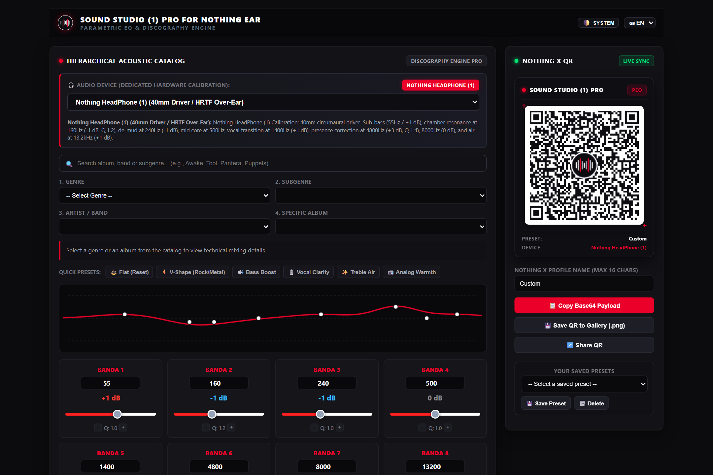
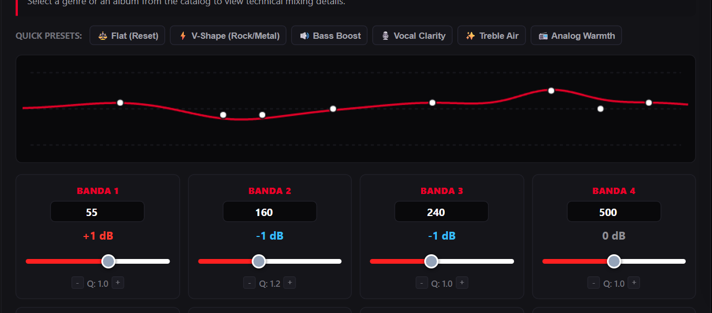
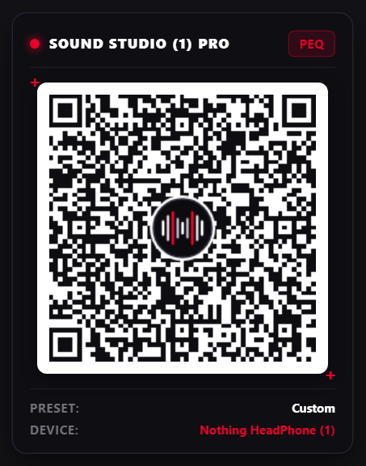
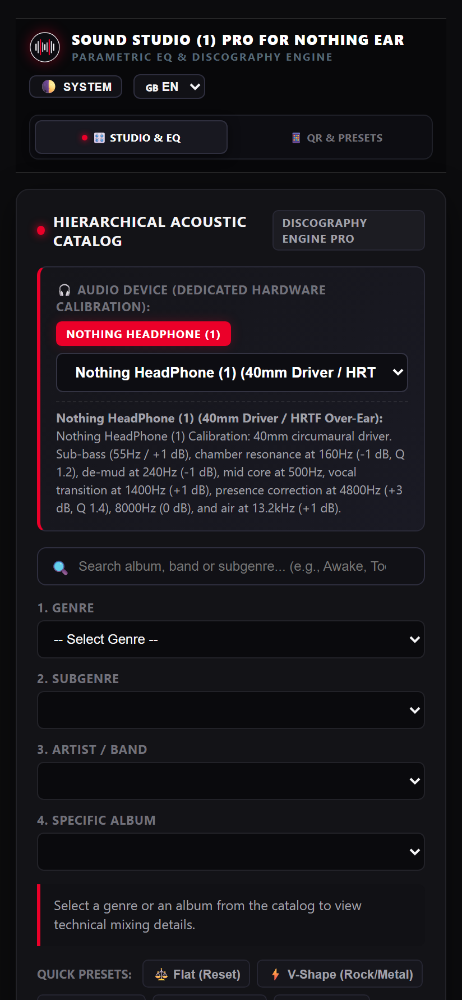
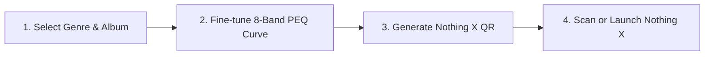

# Sound Studio (1) Pro for Nothing Ear

<div align="center">

```
   _____                      _    _____ _             _ _         __ __   _____           
  / ____|                    | |  / ____| |           | (_)       /_ /_ | |  __ \          
 | (___   ___  _   _ _ __   __| | | (___ | |_ _   _  __| |_  ___   | || | | |__) | __ ___  
  \___ \ / _ \| | | | '_ \ / _` |  \___ \| __| | | |/ _` | |/ _ \  | || | |  ___/ '__/ _ \ 
  ____) | (_) | |_| | | | | (_| |  ____) | |_| |_| | (_| | | (_) | | || | | |   | | | (_) |
 |_____/ \___/ \__,_|_| |_|\__,_| |_____/ \__|\__,_|\__,_|_|\___/  |_||_| |_|   |_|  \___/ 
```

**The Ultimate Acoustic Mastering Suite & Parametric EQ Engine for Nothing Ear & Headphones**

[](https://sound-studio-1-pro.pages.dev/)
[](LICENSE.md)
[](#-curated-acoustic-database-1231-profiles)
[](#-100-offline--standalone-pwa-zero-external-cdns)
[](#-hardware-nothing-x-qr-code-protocol)
[](https://revolut.me/sokkapkd)
[](#-author--copyright)

<br>

🌐 **Live Web App:** [**sound-studio-1-pro.pages.dev**](https://sound-studio-1-pro.pages.dev/)  
🌐 **Read in other languages:** [🇮🇹 **Italiano**](README.it.md)

<br>

[](https://sound-studio-1-pro.pages.dev/)

</div>

---

## 📑 Table of Contents

- [🎧 Overview](#-overview)
- [✨ Key Features](#-key-features)
  - [🎛️ Interactive 8-Band PEQ Engine & Canvas Curve](#️-interactive-8-band-peq-engine--canvas-curve)
  - [📚 Curated Acoustic Database (1,231 Profiles)](#-curated-acoustic-database-1231-profiles)
  - [📱 Hardware Nothing X QR Code Protocol](#-hardware-nothing-x-qr-code-protocol)
  - [🌐 100% Offline & Standalone PWA](#-100-offline--standalone-pwa-zero-external-cdns)
  - [🌍 Multi-Language Support (9 Locales)](#-multi-language-support-9-languages)
- [🎧 Supported Nothing & CMF Devices](#-supported-nothing--cmf-devices)
- [🚀 How to Use](#-how-to-use)
- [🛠️ Project Structure](#️-project-structure)
- [👤 Author & Copyright](#-author--copyright)
- [☕ Support the Project](#-support-the-project)
- [📄 License](#-license)
- [⚠️ Disclaimer](#️-disclaimer)

---

## 🎧 Overview

**Sound Studio (1) Pro** is an open-source, high-fidelity acoustic mastering suite engineered specifically for the Nothing audio ecosystem — including **Nothing Ear**, **Nothing Ear (a)**, **Nothing Ear (2)**, **Nothing HeadPhone (1)**, and **CMF Buds**.

Featuring an interactive **8-band biquad parametric equalizer (PEQ)** and an extensive discography database of **1,231 studio-calibrated album profiles**, it generates instant, hardware-compliant QR codes that can be scanned or imported directly into the official **Nothing X** app.

---

## ✨ Key Features

### 🎛️ Interactive 8-Band PEQ Engine & Canvas Curve

<div align="center">
  
</div>

- **Real-Time Biquad Response**: Interactive frequency canvas with draggable control nodes, dynamically computing biquad filter transfer functions.
- **Full Parametric Control**: 8 discrete frequency bands across the entire human hearing spectrum:
  - **Frequency Range**: 20 Hz – 20,000 Hz
  - **Gain Range**: -6 dB to +6 dB (0.1 dB precision)
  - **Q-Factor (Bandwidth)**: 0.1 to 10.0
- **One-Click Quick Presets**: Instant switches for *Flat (Reset)*, *V-Shape (Rock/Metal)*, *Bass Boost*, *Vocal Clarity*, *Treble Air*, and *Analog Warmth*.

---

### 📚 Curated Acoustic Database (1,231 Profiles)

- **Deep Discographic Calibrations**: Hand-tuned acoustic profiles covering **139 legendary bands/artists** and **1,071 iconic albums**.
- **Encyclopedic Genre Coverage**: Progressive Metal, Thrash, Heavy Metal, Death, Doom, Rock, Metalcore, Nu-Metal, Folk Metal, Power Metal, Jazz, Classical, and Pop.
- **Instant Search with Autocomplete**: Real-time fuzzy search by artist, album name, or release year with keyboard navigation.
- **Studio Mastering Notes**: Dedicated commentary on mix characteristics, tape saturation, dynamic range, and vocal placement for every album.

---

### 📱 Hardware Nothing X QR Code Protocol

<div align="center">
  
</div>

- **Firmware-Compliant Payloads**: Official **zlib-deflated base64** payloads fully compliant with Nothing OS and the Nothing X firmware parser.
- **Live Sync Updates**: QR code and metadata regenerate in real time on every slider adjustment or album selection.
- **⚡ Direct Launch**: Dedicated *"Launch Nothing X"* button for Android to open the Nothing X companion app immediately.
- **Audio Card Export**: High-resolution (300 DPI) visual card with dot-matrix typography, device tag, and mixer badge for photo gallery saving and sharing.

---

### 🌐 100% Offline & Standalone PWA (Zero External CDNs)

<div align="center">
  
</div>

- **Zero External Dependencies**: Local bundling of [`qrcode.min.js`](js/qrcode.min.js) and [`pako.min.js`](js/pako.min.js).
- **Service Worker Caching (`sw.js`)**: Cache-first architecture enabling full offline functionality, in airplane mode, or with zero cellular reception.
- **Cross-Platform PWA**: Installable as a standalone progressive web application on Android, iOS, Windows, macOS, and Linux.

---

### 🌍 Multi-Language Support (9 Languages)

Complete UI localization, buttons, technical labels, and toast messages in:
- 🇬🇧 English, 🇮🇹 Italian, 🇫🇷 French, 🇩🇪 German, 🇪🇸 Spanish, 🇷🇺 Russian, 🇨🇳 Mandarin Chinese, 🇮🇳 Hindi, and 🇸🇦 Modern Standard Arabic (with native RTL layout).

---

## 🎧 Supported Nothing & CMF Devices

Sound Studio (1) Pro applies dedicated acoustical compensation curves based on driver diameter, acoustic cavity resonance, and driver diaphragm materials:

| Category | Device | Driver Type & Calibration Profile |
| :--- | :--- | :--- |
| **Over-Ear Headphones** | **Nothing HeadPhone (1)** | 40mm circumaural driver. Sub-bass boost (55Hz / +1 dB), cavity resonance cleanup (160Hz / -1 dB, Q 1.2), de-mud at 240Hz, vocal presence boost at 4.8kHz (+3 dB). |
| | **Nothing HeadPhone (1) Pro** | Flagship multi-driver over-ear with ultra-wide soundstage compensation. |
| | **Nothing HeadPhone (a)** | 40mm driver, bass tuning correction, presence compensation at 4.8kHz (+2 dB, Q 1.5). |
| | **CMF Headphone Pro** | 40mm dynamic driver, LDAC high-res tuning with low-mid rumble suppression. |
| **Open-Ear & Half In-Ear** | **Nothing Ear (open)** | 14.2mm titanium driver, directional acoustic seal compensation. |
| | **CMF Clip Pro** | Open-ear earhook clip with air-conduction bass compensation. |
| | **Nothing Ear (stick)** | 12.6mm half in-ear driver, low-frequency seal loss correction. |
| **In-Ear Nothing Flagship**| **Nothing Ear (2024)** | Flagship ceramic driver: ultra-fast transience compensation, 6kHz smooth curve. |
| | **Nothing Ear (a)** | Dual-chamber high-energy dynamic driver with balanced mid compensation. |
| | **Nothing Ear (2)** | Graphene driver: anti-fatigue 6kHz sibilance control and deep sub-bass recovery. |
| | **Nothing Ear (1)** | Original Teenage Engineering acoustic tuning profile. |
| **CMF by Nothing** | **CMF Buds Pro 2** | Dual-driver architecture with ultra-bass de-mudding filter. |
| | **CMF Buds 2 Plus** | Dual-driver Hi-Res LDAC with extended treble staging. |
| | **CMF Buds 2 / 2a** | 12.4mm dynamic driver balanced tuning. |
| | **CMF Buds Pro** | Precision-balanced vocal tuning. |
| | **CMF Buds** | Standard dynamic in-ear profile. |
| | **CMF Neckband Pro** | 13.6mm titanium driver with 50dB hybrid ANC compensation. |
| **Studio Reference** | **Direct Studio Master** | 1:1 Flat passthrough with zero hardware offset alteration. |

---

## 🚀 How to Use



1. **Select Device & Preset**:
   - Choose your audio hardware from the dropdown (e.g. *Nothing HeadPhone (1)*, *Nothing Ear 2024*).
   - Search for an artist or album using the instant search bar, or navigate through **Genre → Subgenre → Artist → Album**.
2. **Review & Adjust the Curve**:
   - View the album's technical mastering notes.
   - Adjust control nodes directly on the interactive biquad canvas, or use the gain and Q sliders.
3. **Import to Nothing X**:
   - **Method A (QR Scan)**: Open the **Nothing X** app on your phone, go to Equalizer → Advanced → Scan QR, and point your camera at the screen.
   - **Method B (Direct Launch)**: On Android, tap **"⚡ Launch Nothing X"** to open the companion app directly.
   - **Method C (Save Audio Card)**: Click **"💾 Save QR to Gallery"** to export an ultra-crisp Nothing OS photo card to your camera roll.
4. **Install as Offline PWA**:
   - In Chrome, Edge, or Safari, click **"Install App"** / **"Add to Home Screen"**. The application will function 100% offline.

---

## 🛠️ Project Structure

```
sound-studio-1-pro/
├── index.html                 # Core application markup & Nothing OS layout
├── manifest.webmanifest       # PWA manifest metadata
├── sw.js                      # Cache-first offline Service Worker
├── LICENSE.md                 # CC BY-NC 4.0 legal terms
├── README.md                  # English documentation (this file)
├── README.it.md               # Italian documentation
├── docs/
│   └── screenshots/           # High-resolution application screenshots
│       ├── desktop-hero.png   # Full desktop suite showcase
│       ├── peq-visualizer.png # Interactive 8-band curve visualizer
│       ├── qr-card-preview.png# Nothing OS QR audio card preview
│       └── mobile-view.png    # Mobile smartphone PWA view
├── css/
│   └── style.css              # Nothing OS dark/light theme & dot-matrix typography
├── js/
│   ├── app.js                 # UI controllers, Canvas visualizer & event router
│   ├── database.js            # 1,231 calibrated studio profiles (139 artists)
│   ├── protocol.js            # Nothing X QR compression & binary encoder
│   ├── pako.min.js            # Local zlib deflation engine
│   ├── qrcode.min.js          # Local QR matrix generator
│   └── i18n/                  # Multi-language localization system (9 locales)
└── icons/                     # Nothing OS dot-matrix PWA app icons
```

---

## 👤 Author & Copyright

- **Author & Sound Designer**: **sokkaUmB**
- **Live Web App**: [https://sound-studio-1-pro.pages.dev/](https://sound-studio-1-pro.pages.dev/)
- **Repository**: [https://github.com/sokkaUmB/sound-studio-1-pro](https://github.com/sokkaUmB/sound-studio-1-pro)

---

## ☕ Support the Project

If you enjoy **Sound Studio (1) Pro** and would like to support the ongoing research, acoustical tuning, and development of new album profiles, you can buy me a coffee via Revolut:

👉 **[Support via Revolut (revolut.me/sokkapkd)](https://revolut.me/sokkapkd)**

*(Supports Apple Pay, Google Pay, Revolut, and all major debit/credit cards worldwide).*

---

## 📄 License

This project is licensed under the **Creative Commons Attribution-NonCommercial 4.0 International Public License** ([`CC BY-NC 4.0`](LICENSE.md)).

```
You are free to:
- Share — copy and redistribute the material in any medium or format
- Adapt — remix, transform, and build upon the material

Under the following terms:
- Attribution — You must give appropriate credit to sokkaUmB.
- NonCommercial — You may not use the material for commercial purposes.
```

---

## ⚠️ Disclaimer

*Sound Studio (1) Pro is an independent, open-source community project developed by **sokkaUmB** and is not affiliated with, endorsed by, or sponsored by Nothing Technology Limited.*  
*Nothing, Nothing Ear, Nothing HeadPhone (1), and Nothing X are registered trademarks of Nothing Technology Limited.*
